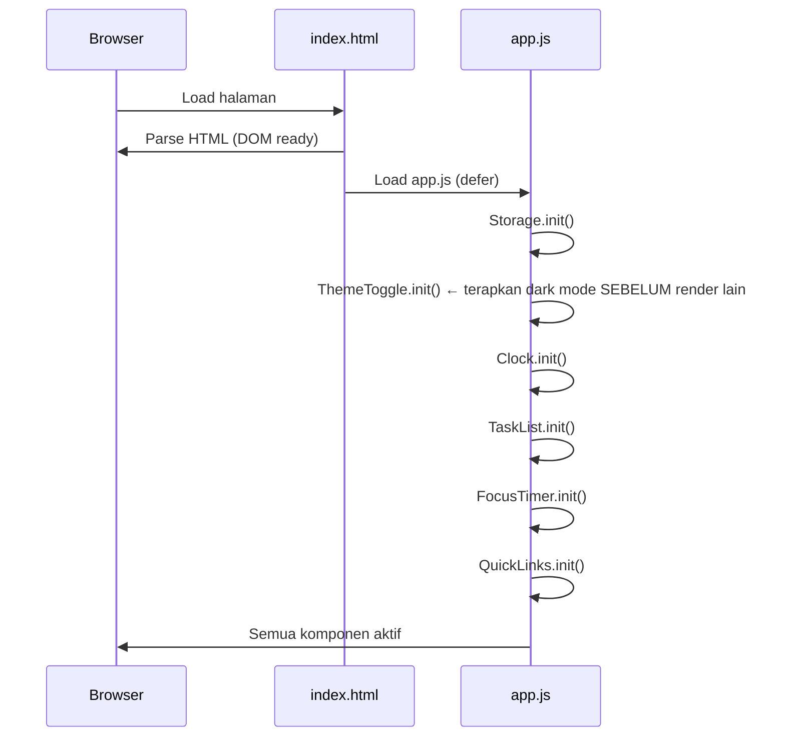
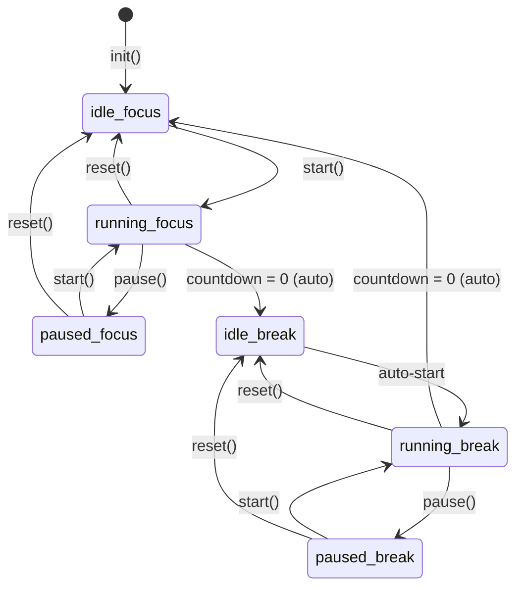

# Design Document

## Overview

Life Dashboard adalah aplikasi web satu halaman (SPA sederhana) yang dijalankan langsung di browser tanpa server backend maupun proses build. Aplikasi ini menggabungkan lima komponen fungsional — Clock, TaskList, FocusTimer, QuickLinks, dan ThemeToggle — dalam satu tampilan terpadu yang dapat diakses di desktop maupun perangkat mobile.

Semua data pengguna disimpan di `localStorage` browser sehingga bersifat persisten antar sesi tanpa memerlukan koneksi jaringan. Aplikasi diimplementasikan menggunakan HTML, CSS, dan Vanilla JavaScript murni, sesuai batasan teknis TC-1 hingga TC-4.

### Tujuan Desain

- **Kecepatan**: Seluruh komponen selesai dirender < 2 detik pada koneksi lokal (NFR-2).
- **Kesederhanaan**: Satu file HTML, satu file CSS, satu file JavaScript — zero dependency.
- **Keandalan**: Semua state kritis disimpan di `localStorage`; tidak ada state yang hilang saat halaman direfresh.
- **Keterbacaan kode**: Setiap komponen diimplementasikan sebagai IIFE module di dalam `app.js` agar mudah dipahami dan di-debug tanpa transpiler.

---

## Architecture

### Struktur File

```
life-dashboard/
├── index.html        # Entry point — markup semantic HTML5
├── css/
│   └── style.css     # Satu file CSS: layout, responsivitas, dark mode, animasi
└── js/
    └── app.js        # Satu file JS: semua modul (Storage, ThemeToggle, Clock, TaskList, FocusTimer, QuickLinks)
```

### Pola Arsitektur

Karena tidak ada framework, digunakan pola **Module Pattern** berbasis IIFE (Immediately Invoked Function Expression) untuk menghindari polusi namespace global. Setiap modul mengekspos API publik melalui objek yang di-assign ke `window` (global namespace terbatas).

```
window
├── Storage        (abstraksi localStorage)
├── ThemeToggle    (light/dark mode)
├── Clock          (jam, tanggal, greeting)
├── TaskList       (CRUD task + sorting)
├── FocusTimer     (countdown Pomodoro)
└── QuickLinks     (CRUD link)
```

### Alur Inisialisasi



### Event Communication

Komponen berkomunikasi lewat **DOM Custom Events** pada `document` untuk menjaga loose coupling:

| Event | Emitter | Listener |
|---|---|---|
| `app:username-saved` | Clock | — |
| `app:theme-changed` | ThemeToggle | — |
| `app:timer-complete` | FocusTimer | — |

Semua state mutation melewati `Storage` untuk konsistensi.

---

## Components and Interfaces

### 1. Storage Module

Abstraksi tipis di atas `localStorage` yang menangani serialisasi JSON dan error handling.

**API Publik:**

```js
Storage.save(key, value)      // JSON.stringify lalu simpan
Storage.load(key, fallback)   // JSON.parse; kembalikan fallback jika null/error
Storage.remove(key)           // hapus key
Storage.clear()               // hapus semua key yang dimiliki app (prefixed)
```

**Storage Keys:**

| Key | Tipe | Deskripsi |
|---|---|---|
| `ld:tasks` | `Task[]` | Daftar task |
| `ld:links` | `Link[]` | Daftar link |
| `ld:config` | `AppConfig` | Konfigurasi pengguna (userName, darkMode, focusDuration, breakDuration) |

**Desain:**
- Semua key diberi prefix `ld:` untuk menghindari collision dengan aplikasi lain.
- `save()` dan `load()` di-wrap dalam `try/catch`; jika `localStorage` tidak tersedia (misal mode private di Safari lama), operasi gagal silently dengan mengembalikan `fallback`.

---

### 2. ThemeToggle Module

Mengatur tema visual (light/dark) dan mencegah FOUC (Flash of Unstyled Content).

**API Publik:**

```js
ThemeToggle.init()            // baca preferensi dari Storage, terapkan tema
ThemeToggle.toggle()          // toggle tema aktif, simpan ke Storage
ThemeToggle.getCurrent()      // kembalikan 'dark' | 'light'
```

**Implementasi Anti-FOUC:**

Untuk mencegah kedipan (Req 6.5), script inline kecil ditempatkan di `<head>` `index.html` — sebelum CSS diload — yang langsung menerapkan class `data-theme="dark"` pada `<html>` berdasarkan nilai `localStorage['ld:config']`:

```html
<head>
  <script>
    (function() {
      try {
        var cfg = JSON.parse(localStorage.getItem('ld:config') || '{}');
        if (cfg.darkMode) document.documentElement.setAttribute('data-theme', 'dark');
      } catch(e) {}
    })();
  </script>
  <link rel="stylesheet" href="css/style.css">
</head>
```

**CSS Dark Mode:**
Dark mode dikontrol via CSS custom properties yang di-override saat `[data-theme="dark"]`:

```css
:root {
  --bg-primary: #ffffff;
  --text-primary: #1a1a1a;
  /* ... */
}
[data-theme="dark"] {
  --bg-primary: #1a1a2e;
  --text-primary: #e0e0e0;
  /* ... */
}
```

---

### 3. Clock Module

Menampilkan jam real-time, tanggal Bahasa Indonesia, dan greeting personal.

**API Publik:**

```js
Clock.init()                  // mulai interval, render pertama
Clock.setUserName(name)       // simpan nama ke Storage, update greeting
Clock.clearUserName()         // hapus nama dari Storage, update greeting
```

**Logic Greeting:**

```
05:00–11:59 → "Selamat Pagi"
12:00–14:59 → "Selamat Siang"
15:00–17:59 → "Selamat Sore"
18:00–04:59 → "Selamat Malam"
```

Jika nama tersimpan: `"{Greeting}, {Nama}!"` — jika tidak: `"{Greeting}!"`

**Update Interval:**
- `setInterval(tick, 1000)` dipanggil saat `init()`.
- Setiap `tick()`: update jam, cek apakah hari berubah (bandingkan date string), cek apakah rentang greeting berubah.

**Format Tanggal:**
Menggunakan `Intl.DateTimeFormat` dengan locale `id-ID`:
```js
new Intl.DateTimeFormat('id-ID', {
  weekday: 'long', day: 'numeric', month: 'long', year: 'numeric'
})
```
Contoh output: `Senin, 21 Oktober 2026`

---

### 4. TaskList Module

Mengelola daftar task dengan operasi CRUD lengkap, edit inline, dan pengurutan.

**API Publik:**

```js
TaskList.init()               // load dari Storage, render
TaskList.addTask(text)        // validasi + tambah task baru
TaskList.toggleTask(id)       // toggle done/undone
TaskList.editTask(id, newText)// validasi + update teks task
TaskList.deleteTask(id)       // hapus task
TaskList.sortBy(sortOrder)    // atur urutan tampilan
```

**Validasi Teks Task:**

| Kondisi | Respons |
|---|---|
| Kosong / hanya spasi | Tampilkan error, tidak tambah |
| > 200 karakter | Tampilkan error dengan info batas, tidak tambah |
| Duplikat (setelah trim) | Tampilkan error duplikat, tidak tambah |

**Sort Orders:**

| SortOrder | Logika |
|---|---|
| `created-newest` | sort descending by `createdAt` |
| `created-oldest` | sort ascending by `createdAt` |
| `incomplete-first` | `done === false` sebelum `done === true`, lalu by `createdAt` |
| `complete-first` | `done === true` sebelum `done === false`, lalu by `createdAt` |

**Edit Inline:**
- Klik tombol edit → ubah `<span>` teks menjadi `<input>` yang bisa diedit.
- Konfirmasi (Enter / tombol save) → validasi → update atau tampilkan error.
- Batal (Escape / tombol cancel) → kembalikan ke tampilan semula.

---

### 5. FocusTimer Module

Countdown timer Pomodoro dengan auto-switch antara Focus dan Break session.

**API Publik:**

```js
FocusTimer.init()             // load durasi dari Storage, set state awal
FocusTimer.start()            // mulai / resume countdown
FocusTimer.pause()            // jeda countdown
FocusTimer.reset()            // reset ke durasi awal sesi aktif
FocusTimer.setFocusDuration(minutes)   // set durasi Focus (1-60), simpan
FocusTimer.setBreakDuration(minutes)   // set durasi Break (1-30), simpan
```

**State Machine:**



**Kontrol Durasi:**
- Kontrol input durasi hanya aktif saat status `idle_focus` atau `idle_break` (Req 3.17).
- Saat `running` atau `paused`, input durasi di-`disabled`.

**Notifikasi In-UI:**
- Ketika countdown mencapai nol, sebuah `<div class="timer-notification">` ditampilkan di dalam antarmuka FocusTimer (bukan browser notification).
- Notifikasi menghilang setelah 3 detik atau saat pengguna berinteraksi kembali.

---

### 6. QuickLinks Module

Menyimpan dan menampilkan daftar tautan cepat.

**API Publik:**

```js
QuickLinks.init()             // load dari Storage, render
QuickLinks.addLink(label, url)// validasi + tambah link baru
QuickLinks.deleteLink(id)     // hapus link, update Storage
QuickLinks.openLink(url)      // window.open(url, '_blank', 'noopener')
```

**Validasi Link:**

| Kondisi | Respons |
|---|---|
| Label kosong | Error: label kosong |
| URL kosong | Error: URL kosong |
| URL tidak diawali `http://` atau `https://` | Error: format URL tidak valid |
| URL duplikat (exact match) | Error: URL sudah terdaftar |
| Jumlah link sudah 50 | Error: daftar sudah penuh |

**Keamanan:**
- `window.open` dipanggil dengan `'noopener,noreferrer'` untuk mencegah reverse tabnapping.

---

## Data Models

### Task

```js
/**
 * @typedef {Object} Task
 * @property {string} id          - UUID unik, dibuat saat task ditambahkan
 * @property {string} text        - Deskripsi tugas (1–200 karakter, sudah di-trim)
 * @property {boolean} done       - Status penyelesaian task
 * @property {number} createdAt   - Unix timestamp (ms) saat task dibuat
 */
```

### Link

```js
/**
 * @typedef {Object} Link
 * @property {string} id          - UUID unik, dibuat saat link ditambahkan
 * @property {string} label       - Nama tampilan link (1–50 karakter)
 * @property {string} url         - URL tujuan (diawali http:// atau https://)
 * @property {number} createdAt   - Unix timestamp (ms) saat link ditambahkan
 */
```

### TimerState

```js
/**
 * @typedef {'focus' | 'break'} TimerMode
 * @typedef {'idle' | 'running' | 'paused'} TimerStatus
 *
 * @typedef {Object} TimerState
 * @property {TimerMode}   mode            - Sesi aktif saat ini
 * @property {TimerStatus} status          - Status timer
 * @property {number}      remaining       - Sisa waktu dalam detik
 * @property {number}      focusDuration   - Durasi Focus dalam menit (1–60)
 * @property {number}      breakDuration   - Durasi Break dalam menit (1–30)
 */
```

### AppConfig

```js
/**
 * @typedef {Object} AppConfig
 * @property {string}  userName       - Nama pengguna (string kosong jika belum diset)
 * @property {boolean} darkMode       - Preferensi dark mode
 * @property {number}  focusDuration  - CustomDuration Focus dalam menit (default: 25)
 * @property {number}  breakDuration  - CustomDuration Break dalam menit (default: 5)
 */
```

**Default AppConfig:**
```js
const DEFAULT_CONFIG = {
  userName: '',
  darkMode: false,
  focusDuration: 25,
  breakDuration: 5
};
```

---

## Correctness Properties

*A property is a characteristic or behavior that should hold true across all valid executions of a system — essentially, a formal statement about what the system should do. Properties serve as the bridge between human-readable specifications and machine-verifiable correctness guarantees.*

### Property 1: Storage round-trip preserves data

*For any* JavaScript object (Task, Link, atau AppConfig), menyimpan objek tersebut ke Storage lalu memuatnya kembali harus menghasilkan objek yang strukturnya identik dengan objek aslinya.

**Validates: Requirements 2.15, 2.16, 4.9, 4.10, 6.4**

---

### Property 2: Greeting selalu sesuai jam

*For any* nilai jam dalam rentang 0–23, fungsi `getGreeting(hour)` harus mengembalikan tepat satu dari empat string yang terdefinisi: "Selamat Pagi" (5–11), "Selamat Siang" (12–14), "Selamat Sore" (15–17), atau "Selamat Malam" (18–4), dan tidak pernah mengembalikan string di luar empat nilai tersebut.

**Validates: Requirements 1.6**

---

### Property 3: Greeting dengan nama vs tanpa nama

*For any* string nama yang tersimpan (non-empty), `formatGreeting(greeting, name)` harus mengembalikan string yang berakhiran `", {name}!"`. Sebaliknya, jika nama adalah string kosong, hasilnya harus berakhiran `"!"` tanpa nama.

**Validates: Requirements 1.7, 1.8**

---

### Property 4: Penambahan task memperbesar daftar

*For any* daftar Task dan teks task yang valid (panjang 1–200 karakter, tidak semua spasi, tidak duplikat), memanggil `addTask(text)` harus menghasilkan daftar baru yang panjangnya bertambah tepat satu dari panjang semula.

**Validates: Requirements 2.2**

---

### Property 5: Teks kosong dan duplikat ditolak

*For any* string yang seluruhnya terdiri dari karakter spasi atau tabulasi, `addTask(text)` harus mengembalikan error dan daftar task tidak boleh berubah panjangnya. Demikian pula, *for any* teks yang setelah di-trim identik dengan teks task yang sudah ada dalam daftar, penambahan harus ditolak.

**Validates: Requirements 2.3, 2.5**

---

### Property 6: Toggle status task adalah involution

*For any* task dalam daftar, memanggil `toggleTask(id)` dua kali berturut-turut harus menghasilkan task dengan status `done` yang sama dengan status awal — yaitu toggle adalah operasi involutif (self-inverse).

**Validates: Requirements 2.6, 2.7**

---

### Property 7: Sorting task tidak mengubah isi, hanya urutan

*For any* daftar Task dan *for any* SortOrder yang valid, memanggil `sortBy(order)` tidak boleh menambah, menghapus, atau mengubah isi Task — hanya mengubah urutan tampilan. Jumlah task sebelum dan sesudah sort harus sama, dan setiap task harus tetap ada dengan `id`, `text`, dan `done` yang tidak berubah.

**Validates: Requirements 2.14**

---

### Property 8: Sorting incomplete-first mempertahankan urutan relatif dalam grup

*For any* daftar Task dengan mode sort `incomplete-first`, semua task dengan `done === false` harus muncul sebelum semua task dengan `done === true`. Secara simetris, mode `complete-first` harus memastikan semua task dengan `done === true` muncul sebelum task dengan `done === false`.

**Validates: Requirements 2.14**

---

### Property 9: Validasi URL Quick Links

*For any* string URL yang tidak diawali tepat dengan `http://` atau `https://`, fungsi `validateUrl(url)` harus mengembalikan hasil invalid. Sebaliknya, *for any* string yang diawali `http://` atau `https://` dengan panjang 1–2000 karakter, fungsi harus mengembalikan valid.

**Validates: Requirements 4.4**

---

### Property 10: Kapasitas Quick Links tidak terlampaui

*For any* daftar Link dengan jumlah tepat 50 entri, mencoba menambahkan link baru harus selalu ditolak dan daftar harus tetap berisi tepat 50 entri.

**Validates: Requirements 4.1, 4.6**

---

### Property 11: FocusTimer countdown monoton menurun

*For any* kondisi timer yang sedang berjalan (`status === 'running'`), setiap tick dari `setInterval` harus menghasilkan nilai `remaining` yang berkurang tepat satu detik dari nilai sebelumnya, selama `remaining > 0`.

**Validates: Requirements 3.3**

---

### Property 12: Reset timer mengembalikan ke durasi penuh sesi aktif

*For any* state timer (running atau paused), memanggil `reset()` saat mode `focus` harus menghasilkan `remaining === focusDuration * 60` dan `status === 'idle'`. Saat mode `break`, `remaining === breakDuration * 60` dan `status === 'idle'`.

**Validates: Requirements 3.5, 3.6**

---

### Property 13: CustomDuration di luar rentang ditolak

*For any* nilai integer `n` di luar rentang 1–60 (untuk Focus) atau 1–30 (untuk Break), memanggil `setFocusDuration(n)` atau `setBreakDuration(n)` harus mengembalikan error dan nilai durasi di Storage tidak boleh berubah.

**Validates: Requirements 3.14, 3.15**

---

### Property 14: Dark mode toggle adalah round-trip

*For any* state dark mode awal (aktif atau tidak aktif), memanggil `ThemeToggle.toggle()` dua kali berturut-turut harus menghasilkan state yang identik dengan state awal — tema yang sama diterapkan dan preferensi yang sama tersimpan di Storage.

**Validates: Requirements 6.2, 6.3, 6.4**

---

## Error Handling

### Strategi Umum

Semua error yang dihadapi pengguna ditampilkan sebagai **inline error message** di dekat elemen yang menyebabkan error — bukan sebagai `alert()` browser. Pesan error menggunakan Bahasa Indonesia dan bersifat spesifik (menyebutkan field mana yang bermasalah atau batas mana yang dilanggar).

### Error Messages per Komponen

**TaskList:**

| Kondisi | Pesan Error |
|---|---|
| Teks kosong / hanya spasi | "Deskripsi tugas tidak boleh kosong." |
| Teks > 200 karakter | "Deskripsi tugas maksimal 200 karakter." |
| Teks duplikat | "Tugas dengan deskripsi yang sama sudah ada." |

**FocusTimer:**

| Kondisi | Pesan Error |
|---|---|
| Durasi Focus < 1 atau > 60 | "Durasi fokus harus antara 1 hingga 60 menit." |
| Durasi Break < 1 atau > 30 | "Durasi istirahat harus antara 1 hingga 30 menit." |
| Input bukan bilangan bulat | "Masukkan bilangan bulat yang valid." |

**QuickLinks:**

| Kondisi | Pesan Error |
|---|---|
| Label kosong | "Label tidak boleh kosong." |
| URL kosong | "URL tidak boleh kosong." |
| URL tidak valid (tanpa http/https) | "URL harus diawali dengan http:// atau https://." |
| URL duplikat | "URL tersebut sudah terdaftar." |
| Daftar penuh (50 link) | "Daftar tautan sudah penuh (maksimal 50)." |

### Penanganan localStorage Tidak Tersedia

Jika `localStorage` melempar exception (misal mode private browser tertentu):
- `Storage.save()` dan `Storage.load()` menangkap exception dalam `try/catch`.
- `Storage.load()` mengembalikan nilai `fallback` yang diberikan.
- Aplikasi tetap berfungsi tanpa persistensi (data hilang saat halaman direfresh) tanpa error yang terlihat pengguna.

### Penanganan Nilai localStorage yang Korup

Jika data yang tersimpan di `localStorage` tidak dapat di-parse sebagai JSON yang valid (misal karena data dari aplikasi lain atau korupsi):
- `Storage.load()` menangkap `JSON.parse` error dan mengembalikan `fallback`.
- Setiap modul menggunakan fallback yang aman (array kosong untuk tasks/links, default config untuk AppConfig).

---

## Testing Strategy

### Pendekatan

Karena aplikasi menggunakan Vanilla JavaScript tanpa framework atau build step (TC-1, TC-3), dan sesuai NFR-3 yang tidak mensyaratkan test setup, strategi testing utama adalah **pengujian manual terstruktur** yang dilengkapi **pengujian browser developer tools**.

Untuk validasi correctness properties secara formal, direkomendasikan penggunaan **fast-check** (library property-based testing untuk JavaScript) jika tim ingin menambahkan automated testing di masa depan — tetapi ini bersifat opsional dan tidak diperlukan untuk delivery awal.

### Manual Testing Checklist

Setiap komponen diverifikasi secara manual menggunakan checklist terstruktur di browser:

**Clock:**
- [ ] Jam berformat HH:MM:SS dan berdetak setiap detik
- [ ] Tanggal tampil dalam Bahasa Indonesia
- [ ] Greeting berganti saat jam masuk rentang baru
- [ ] Nama tersimpan dan ditampilkan di greeting
- [ ] Refresh halaman mempertahankan nama

**TaskList:**
- [ ] Tambah task valid → muncul di daftar
- [ ] Tambah task kosong → pesan error
- [ ] Tambah task > 200 karakter → pesan error
- [ ] Tambah task duplikat → pesan error
- [ ] Toggle done → strikethrough muncul/hilang
- [ ] Edit task → inline edit berfungsi
- [ ] Hapus task → hilang dari daftar
- [ ] Semua 4 mode sort berfungsi
- [ ] Refresh halaman → data tetap ada

**FocusTimer:**
- [ ] Timer menghitung mundur dengan benar
- [ ] Start / Pause / Reset berfungsi
- [ ] Saat Focus = 0 → auto switch ke Break, notifikasi muncul
- [ ] Saat Break = 0 → auto switch ke Focus baru, notifikasi muncul
- [ ] Custom duration disimpan dan diterapkan
- [ ] Input durasi disabled saat timer berjalan/dijeda

**QuickLinks:**
- [ ] Tambah link valid → muncul
- [ ] Validasi label/URL kosong → pesan error
- [ ] URL tanpa http/https → pesan error
- [ ] URL duplikat → pesan error
- [ ] Klik link → buka tab baru
- [ ] Hapus link → hilang
- [ ] Tambah link ke-51 → pesan error

**ThemeToggle:**
- [ ] Toggle switch mengubah tema secara langsung
- [ ] Preferensi bertahan setelah refresh
- [ ] Tidak ada kedipan (FOUC) saat load halaman dark mode

**Responsivitas:**
- [ ] Layout benar di lebar ≥ 1024px (semua komponen tampil)
- [ ] Layout 2 kolom di lebar 768–1023px
- [ ] Layout 1 kolom di lebar < 768px, tidak ada overflow horizontal

### Property-Based Testing (Opsional / Future)

Jika automated testing ditambahkan, gunakan **fast-check** (npm install fast-check — hanya untuk testing, bukan production) untuk mengotomatisasi validasi Correctness Properties 1–14. Setiap test dikonfigurasi minimal 100 iterasi.

Contoh tag untuk traceability:
```
// Feature: life-dashboard, Property 2: Greeting selalu sesuai jam
// Feature: life-dashboard, Property 4: Penambahan task memperbesar daftar
```

### Browser DevTools Verification

Selain checklist manual, gunakan DevTools untuk:
- **Application → Local Storage**: verifikasi data tersimpan dengan benar setelah setiap operasi
- **Console**: pastikan tidak ada uncaught exceptions
- **Performance**: pastikan tidak ada memory leak dari `setInterval` yang tidak di-clear
- **Responsive Design Mode**: uji breakpoints 768px dan 1024px
